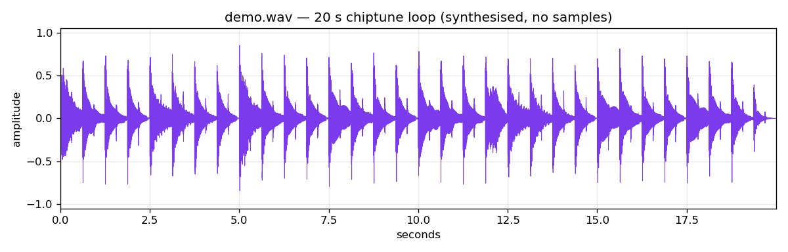
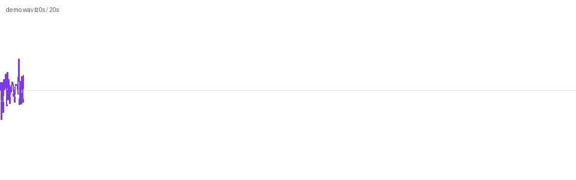

# Shorts Music Generator

A tiny Python script that synthesises an upbeat chiptune loop for short videos — chords, melody, bass and drums, all generated from scratch with sine and triangle waves (NumPy). No copyrighted audio, no samples, no licence fees.




🎧 Listen to the demo: [`screenshots/demo.wav`](screenshots/demo.wav) — 20 seconds, mono 16-bit WAV, generated by this script with the default settings.

## Why this exists

Short videos need music, and using someone else's song risks a copyright claim. This script makes a simple, cheerful loop you can use freely — it was written for a 20-second Short, where the track runs under the video.

## What it makes

- **Default:** a 20-second upbeat loop, chords C – Am – F – G, playful pentatonic melody, bass, kick/hat drums, and bright chimes at 0s, 5s and 12s (handy for scene cuts).
- **Output:** mono 16-bit WAV, 44.1 kHz, normalised to 0.85 peak with a short fade-in and a 1-second fade-out.

## Usage

```bash
pip install -r requirements.txt

python src/shorts_music.py                      # 20s -> music.wav
python src/shorts_music.py -o intro.wav -d 10  # 10s -> intro.wav
python src/shorts_music.py --no-chimes          # no scene-cut chimes
python src/shorts_music.py --chimes 0,4,9       # chimes at 0s, 4s, 9s
```

Options:

| Flag | What it does |
| --- | --- |
| `-d`, `--duration` | Track length in seconds (default: `20`) |
| `-o`, `--output` | Output WAV file (default: `music.wav`) |
| `--chimes` | Comma-separated seconds for chimes (default: `0,5,12`) |
| `--no-chimes` | Skip the chimes entirely |

## Make it yours

The sound is one fixed pattern — edit these at the top of `src/shorts_music.py`:

- `CHORD_ROOTS` / `CHORD_TONES` — the chord progression (default: C, Am, F, G)
- `MELODY` — the melody, one MIDI note per step (`0` = rest)
- `CHIME_NOTES` — the bright arpeggio played at each chime time

Change the numbers, re-run, and the whole track follows.

## Honest notes

- This makes **simple chiptune loops, not studio music**. One sound, one pattern, no vocals, no mixing desk. It is meant to sit quietly under a 20-second video, not to be listened to on its own.
- The melody and chords are fixed patterns, not generated per run — two runs with the same settings produce the same track (the hi-hat noise is seeded, so it is deterministic too).
- The demo files in `screenshots/` were generated with this script: `demo.wav` with the defaults, `waveform.png` plotted from that file, and `waveform-draw.gif` is an animation of the same waveform drawing itself — all made by code, nothing faked.
- Requirements: Python 3.8+ and NumPy only. No audio libraries, no network, no API keys.

## License

MIT — see [LICENSE](LICENSE). Use the music it makes however you like.
